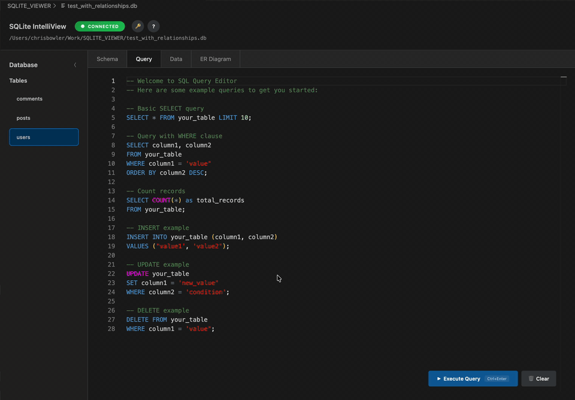

<h1 align="center">SQLite IntelliView</h1>

<p align="center">
  
</p>

<p align="center">
  <strong>See, edit, and explore SQLite — right in your editor.</strong><br />
  Browse tables, run queries, and follow relationships.<br />
  Local, offline, and free. Available through VS Code Marketplace and Open VSX.
</p>

<p align="center">
  <a href="https://github.com/Bowlerr/sqlite-intelliview-vscode/releases/latest"></a>
  <a href="https://github.com/Bowlerr/sqlite-intelliview-vscode/blob/HEAD/LICENSE"></a>
</p>

<p align="center">
  <a href="https://marketplace.visualstudio.com/items?itemName=bowlerr.sqlite-intelliview-vscode"><strong>Install for VS Code</strong></a>
  &nbsp;·&nbsp; <a href="https://open-vsx.org/extension/bowlerr/sqlite-intelliview-vscode"><strong>Install from Open VSX</strong></a>
  &nbsp;·&nbsp; <a href="#supported-editors">Supported editors</a>
  &nbsp;·&nbsp; <a href="#quick-start">Quick start</a>
  &nbsp;·&nbsp; <a href="#see-it-in-action">Demos</a>
  &nbsp;·&nbsp; <a href="#settings">Settings</a>
  &nbsp;·&nbsp; <a href="https://github.com/Bowlerr/sqlite-intelliview-vscode/issues">Report an issue</a>
</p>

> **Beta:** actively evolving. Your database contents stay on your machine; the extension has no cloud service or telemetry. See [editing and limits](#editing-and-limits) before working with important or shared data.

## Your database, in context

| Work with | What you can do |
| --- | --- |
| **Tables** | Open multiple tabs, reorder them, and browse with pagination, page search, column filters, sorting, pinning, and resizable rows and columns. |
| **Cells and rows** | Edit values inline, select rows with checkboxes, export a selection, and delete selected rows in one transaction. |
| **SQL** | Use the bundled Monaco editor, keep query results in separate tabs, and choose your result limits. |
| **Relationships** | Inspect columns and keys, follow foreign-key links, and explore an interactive ER diagram. |
| **JSON and BLOBs** | Expand values, view formatted JSON and images, or copy data as JSON, Base64, or Hex. |
| **Files** | Open SQLite or SQLCipher databases, monitor external changes, and checkpoint write-ahead logs. |

## Supported editors

SQLite IntelliView uses the **VS Code 1.101+ extension API** and a desktop Node.js extension host. The same extension is distributed through VS Code Marketplace, Open VSX, and the release VSIX.

| Editor | Installation |
| --- | --- |
| **Visual Studio Code** | [Install from VS Code Marketplace](https://marketplace.visualstudio.com/items?itemName=bowlerr.sqlite-intelliview-vscode). |
| **[VSCodium](https://github.com/VSCodium/vscodium/blob/master/docs/extensions.md)** | Search for **SQLite IntelliView** in Extensions, using its default [Open VSX registry](https://open-vsx.org/extension/bowlerr/sqlite-intelliview-vscode). |
| **[Cursor](https://cursor.com/help/customization/extensions)** | Search for **SQLite IntelliView** in its Open VSX-backed extension catalog. Availability can depend on the editor's catalog policies. |
| **Other compatible desktop editors** | Install from [Open VSX](https://open-vsx.org/extension/bowlerr/sqlite-intelliview-vscode) when supported, or use **Extensions: Install from VSIX…** with a package from [GitHub Releases](https://github.com/Bowlerr/sqlite-intelliview-vscode/releases). |

Release tests run in Visual Studio Code. Other editors must provide the required extension API and are not individually validated by this project's test suite. Browser-only extension hosts are not supported.

Missing your editor, or something is not working? **[Report an editor compatibility issue](https://github.com/Bowlerr/sqlite-intelliview-vscode/issues/new?title=Editor+compatibility%3A+&body=%23%23%23+Editor%0AName+and+version%3A%0A%0A%23%23%23+Environment%0AOperating+system%3A%0ASQLite+IntelliView+version%3A%0AInstalled+from+%28VS+Code+Marketplace+%2F+Open+VSX+%2F+VSIX%29%3A%0A%0A%23%23%23+What+happened%3F%0ADescribe+the+missing+support+or+problem%2C+and+what+you+expected.%0A%0A%23%23%23+Steps+to+reproduce%0A1.+%0A%0A%23%23%23+Relevant+error+messages%0AInclude+non-sensitive+messages+if+available.%0A)**. The form includes fields for your editor, version, operating system, installation source, and steps to reproduce.

## Quick start

1. [Install SQLite IntelliView](https://marketplace.visualstudio.com/items?itemName=bowlerr.sqlite-intelliview-vscode) in **VS Code 1.101 or later**, or install it from [Open VSX](https://open-vsx.org/extension/bowlerr/sqlite-intelliview-vscode) in a compatible editor supporting the same extension API.
2. Open a database file. Supported extensions are `.sqlite`, `.sqlite3`, `.db`, `.db3`, `.s3db`, and `.sl3`, including uppercase variants.
3. If prompted, choose **Open With… → SQLite Database IntelliView**. You can also right-click a file and choose **Open SQLite Database**.
4. Choose a table, then use **Data** to browse and edit, **Schema** to inspect columns, **Query** to run SQL, or **Diagram** to explore relationships.

The **Database Explorer** lists tables and columns alongside your editor. For a different filename extension, use [custom file extensions](#custom-file-extensions). For an encrypted file, follow [SQLCipher setup](#sqlcipher-encrypted-databases).

## See it in action

<table>
  <tr>
    <td width="50%" valign="top">
      <strong>Browse and edit</strong><br />
      
    </td>
    <td width="50%" valign="top">
      <strong>Ask your data a question</strong><br />
      
    </td>
  </tr>
</table>

Open a focused demo:

| Explore | Inspect | Connect |
| --- | --- | --- |
| [Multiple table tabs](images/Tab-Organisation.gif) | [Schema view](images/Schema.gif) | [Foreign-key navigation](images/Relationation-Query.gif) |
| [ER diagrams](images/Diagram.gif) | [JSON viewer](images/Json-Viewer.gif) | [SQLCipher databases](images/encryption.gif) |
| [External updates](images/external-updates.gif) | [BLOB viewer](images/Blob-Viewer.gif) | |

## Editing and limits

**Select, export, delete.** Use a row checkbox or click a row to select it. The header checkbox selects all filtered rows on the current page, including rows outside the virtual viewport. A new table snapshot or filter change clears the selection. **Export Selected** writes the selected rows as CSV; **Delete Selected** asks for confirmation and commits the selection together or rolls it back.

**Keep text intact.** Control characters display as `\n`, `\r`, `\t`, `\b`, `\f`, or `\u0000`; a literal backslash displays as `\\`. Use the same escapes while editing. Invalid escapes keep the editor open without saving. CSV exports preserve original text and quote multiline fields.

| Keep in mind | Current behavior |
| --- | --- |
| **Persisted changes** | Inline edits and row deletion write to the database file. Work on a copy when the data is important or another process also uses it. |
| **Query-editor writes** | SQL writes change the in-memory database and are **not saved automatically**. A later inline edit or deletion can save that in-memory state. Use a dedicated SQLite client for SQL write workflows. |
| **Safe row identity** | Views and tables without a usable, stable row identity are read-only. |
| **Virtual tables** | Selection and export remain available; row deletion is disabled. Supported modules, such as FTS3, retain inline cell editing when rows have stable identities. |
| **FTS5** | Schema and ER views can read FTS5 declarations. The bundled engine does **not** support executing FTS5 queries or views that query those tables. |
| **Search and export scope** | Table search and filters operate on the loaded page. CSV export includes that page's visible or selected rows. |
| **Result size** | Queries return up to **10,000 rows** by default, with a notice when truncated. [Configure the limits](#settings) for larger results; larger pages and unlimited results use more memory. |
| **Restricted SQL** | The query editor blocks statements such as `PRAGMA key`, `ATTACH DATABASE`, and `DETACH DATABASE`. |

## Settings

Open your editor's Settings and search for **SQLite IntelliView**, or edit `settings.json`. All names below use the `sqliteIntelliView.` prefix.

### Rows and results

| Setting | Default | Purpose |
| --- | --- | --- |
| `defaultPageSize` | `1000` | Initial table page size, capped by `maxTablePageSize`. |
| `maxTablePageSize` | `100000` | Maximum rows per table page. Set to `0` for no configured cap. |
| `queryMaxRows` | `10000` | Maximum query-result rows. Set to `0` for no configured cap. Schema and ER metadata are unaffected. |

Choose **Custom…** in the rows-per-page selector to enter a positive whole number. The cap is applied before calculating the new page. Caps accept non-negative safe integers; invalid settings fall back to their defaults.

### WAL and external changes

| Setting | Default | Purpose |
| --- | --- | --- |
| `walCheckpointMode` | `"full"` | `full` attempts a full checkpoint, `passive` makes a less intrusive attempt, and `off` skips automatic checkpointing. |
| `walAutoCheckpoint` | `true` | Compatibility switch: `false` disables automatic checkpointing regardless of the mode. |
| `walMonitoring` | `true` | Watches database, WAL, and SHM files for external changes. |
| `externalRefreshDebounceMs` | `500` | Groups nearby file events into one refresh. Increase this for busy external writers. |

### Custom file extensions

```json
{
  "sqliteIntelliView.additionalFileExtensions": [".database", "sqlite-backup"]
}
```

Values may include a leading dot and are matched case-insensitively. Invalid or duplicate entries are ignored. The setting updates IntelliView's open dialogs and commands; it does not dynamically change VS Code's custom-editor associations or Explorer context menu. Use **SQLite IntelliView: Open SQLite Database** to choose a custom-extension file.

## SQLCipher encrypted databases

Install the `sqlcipher` command-line tool and make it available on your `PATH`. Then run **SQLite IntelliView: Connect with SQLCipher Key** from the Command Palette and enter your key. IntelliView uses SQLCipher to decrypt, re-encrypt, and checkpoint encrypted databases.

| Platform | Install SQLCipher |
| --- | --- |
| macOS / Homebrew | `brew install sqlcipher` |
| Ubuntu / Debian | `sudo apt-get update && sudo apt-get install -y sqlcipher` |
| Windows / MSYS2 | `pacman -S mingw-w64-x86_64-sqlcipher`, or install another SQLCipher build and add `sqlcipher.exe` to `PATH`. |

Verify with `sqlcipher -version`. Need help with `PATH`? See the [Windows guide](readme/windows-path-setup.md) or [macOS guide](readme/macos-path-setup.md).

## WAL and SQLite tools

For databases using write-ahead logging, IntelliView attempts a checkpoint before loading and refreshes when monitored files change. It uses a bundled `sqlite3` executable when available, then falls back to one on your `PATH`. Ordinary SQLite files can still open without a CLI, but checkpointing may be unavailable.

To install a system SQLite CLI:

| Platform | Install SQLite |
| --- | --- |
| macOS / Homebrew | `brew install sqlite` |
| Ubuntu / Debian | `sudo apt-get update && sudo apt-get install -y sqlite3` |
| Windows | `winget install --id SQLite.SQLite -e` or `choco install sqlite` |

Verify with `sqlite3 --version`. Use **SQLite IntelliView: Checkpoint WAL and Refresh** to request a checkpoint manually. A locked database or read-only access can prevent checkpointing and leave the displayed data stale.

## Commands and shortcuts

All commands below appear under **SQLite IntelliView:** in the Command Palette.

| Command | Windows / Linux | macOS |
| --- | --- | --- |
| **Open SQLite Database** | `Ctrl+Shift+O` | `Cmd+Shift+O` |
| **Connect with SQLCipher Key** | `Ctrl+Shift+K` | `Cmd+Shift+K` |
| **Refresh Database** | `Ctrl+Shift+R` | `Cmd+Shift+R` |
| **Checkpoint WAL and Refresh** | — | — |

The Command Palette's **Export Data** command (`Ctrl+Shift+E` / `Cmd+Shift+E`) is a placeholder. Use the table's **Export** or **Export Selected** controls for CSV export.

While focus is inside the IntelliView editor:

| Action | Windows / Linux | macOS |
| --- | --- | --- |
| Run query | `Ctrl+Enter` | `Cmd+Enter` |
| Clear query | `Ctrl+K` | `Cmd+K` |
| Focus table search | `Ctrl+F` or `/` on the Data tab | `Cmd+F` or `/` on the Data tab |
| Refresh the current view | `Ctrl+Shift+R` | `Cmd+Shift+R` |
| Reload the database from disk | `Ctrl+Alt+R` | `Cmd+Option+R` |

## Troubleshooting

| Symptom | Try this |
| --- | --- |
| Database locked or checkpoint fails | Close other apps holding the file, then run **Checkpoint WAL and Refresh**. |
| Encrypted database will not open | Check that `sqlcipher -version` works, then reconnect with the correct key. |
| WAL data appears stale | Confirm that checkpointing is enabled and the database is writable. Another active writer may prevent a complete checkpoint. |
| Repeated external-change notifications | Keep monitoring enabled and increase `externalRefreshDebounceMs`, for example to `750` or `1000`. |

Still stuck? [Open an issue](https://github.com/Bowlerr/sqlite-intelliview-vscode/issues) with your editor's name, version, and steps to reproduce. Avoid including private database contents or encryption keys.

## Project

[Release notes](CHANGELOG.md) · [MIT license](LICENSE) · [Issues and feedback](https://github.com/Bowlerr/sqlite-intelliview-vscode/issues)

Built with locally bundled **sql.js**, **Monaco Editor**, **D3**, and **SortableJS**.
